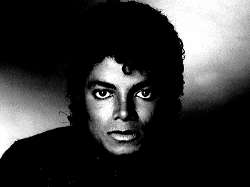

# CURRÍCULUM VITAE – MARC FLORES

## DADES PERSONALS

- **Nom:** Marc Flores

 
  
- **Telèfon:** 727364547
  
- **Correu electrònic:** heehee@gmail.com
  
- **Ciutat:** L'Hospitalet de Llobregat
  
- **GitHub:** [El meu perfil](https://github.com/marcfloresgutsens08)
  

## PERFIL PROFESSIONAL

Estudiant de CFGS de Desenvolupament d'Aplicacions Multiplataforma, interessat en el món de la tecnologia i la programació. Em considero una persona responsable, constant i amb ganes d'aprendre. Busco adquirir experiència professional i continuar desenvolupant les meves habilitats en l'àmbit informàtic.

## EXPERIÈNCIA LABORAL

Actualment no tinc experiència laboral, però m'agradaria treballar en el sector de la informàtica, especialment en el desenvolupament d'aplicacions i programari.

El meu objectiu és incorporar-me a una empresa tecnològica on pugui:

- Participar en projectes de desenvolupament d'aplicacions.
  
- Aprendre a treballar en equip.
  
- Aplicar els coneixements adquirits durant els estudis.
  
- Millorar les meves habilitats tècniques i professionals.
  

## FORMACIÓ ACADÈMICA

- **2026 – Actualitat:** CFGS de Desenvolupament d'Aplicacions Multiplataforma (DAM).
  
  - Institut Provençana.
    
- **2024 – 2026:** Batxillerat.
  
  - INS Palleja.
    

## FORMACIÓ ALTERNATIVA

- **Natació:** experiència esportiva continuada, que m'ha ajudat a desenvolupar la constància, la disciplina i la capacitat de superació.
  

## IDIOMES

| Idioma | Nivell |
| --- | --- |
| Català | C1 |
| Castellà | C1 |
| Anglès | C1 |

## COMPETÈNCIES

**Competències tècniques (Hard Skills):**

- Coneixements bàsics de Java.
  
- HTML i desenvolupament web.
  
- SQL i bases de dades.
  
- Git i GitHub.
  
- Ús de sistemes operatius Windows i Linux.
  

**Competències personals (Soft Skills):**

- Treball en equip.
  
- Responsabilitat.
  
- Constància.
  
- Capacitat d'aprenentatge.
  
- Resolució de problemes.
  

## HOBBIES I INTERESSOS

1. Informàtica i noves tecnologies.
   
2. Videojocs i entreteniment digital.
   
3. Esport i natació.
   
4. Cinema i sèries.
   
5. Aprendre coses noves relacionades amb la tecnologia.
   

* * *

*La meva motivació principal és continuar aprenent i convertir la meva passió per la tecnologia en una* ***professió*** *de futur.*

📌 Disponibilitat per continuar formant-me i adquirir experiència professional.

[GitHub](https://github.com/marcfloresgutsens08) · [Tutorial Markdown](https://tutorialmarkdown.com/)